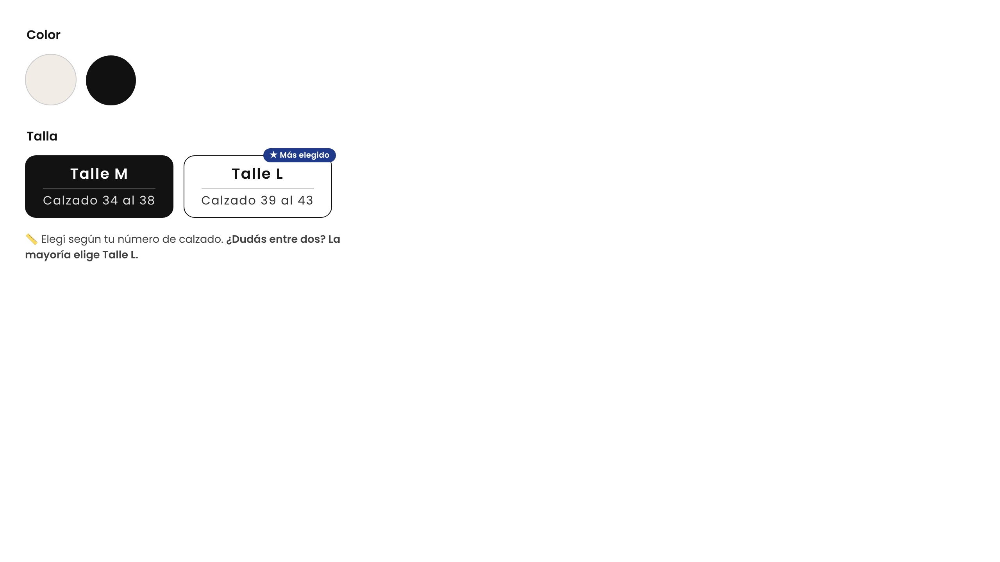

# Selector de talles con referencia de calzado (Shopify)

Convierte los botones "Talle M / Talle L" en tarjetas con el rango de calzado y destaca el Talle L como "Más elegido".



## Instalación (Editar código)

1. Shopify > **Tienda online > Temas > ··· > Editar código**.
2. Carpeta **snippets** > **Agregar un nuevo snippet** > `selector-talles` > pegar el contenido de `selector-talles.liquid` > Guardar.
3. Abrir `layout/theme.liquid` y pegar justo antes de `</body>`:

   ```liquid
   
   ```

4. Guardar y revisar un producto en compu y celular.

## Requisitos

- Los valores de la variante tienen que llamarse exactamente **Talle M** y **Talle L** (mayúsculas no importan).
- El selector de talle tiene que estar en modo **botones** (no desplegable) en el bloque "Selector de variantes".

## Editar textos

Arriba del `<script>`, en `TALLES`, se cambia el rango (`sub`), el sello (`badge`) y en `HINT` la frase de ayuda.
Para sacar el sello "Más elegido", borrá `, badge: '★ Más elegido'`.

## Color preseleccionado (Blanco)

Al entrar al producto se elige automáticamente el color **Blanco** (lista `COLOR_INICIAL`).
No se aplica si el link ya trae una variante (`?variant=...`, por ejemplo desde un anuncio), ni si el blanco está agotado.
Funciona cuando el color se muestra como botones o muestras; si el color está en un desplegable, conviene reordenar las variantes en el admin (poner Blanco primero).
